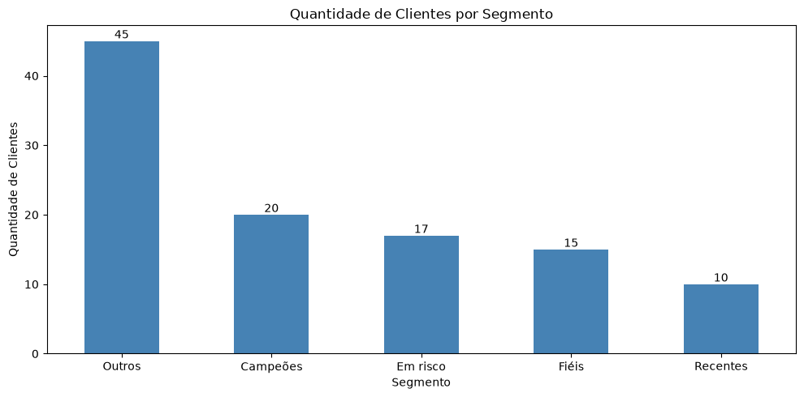
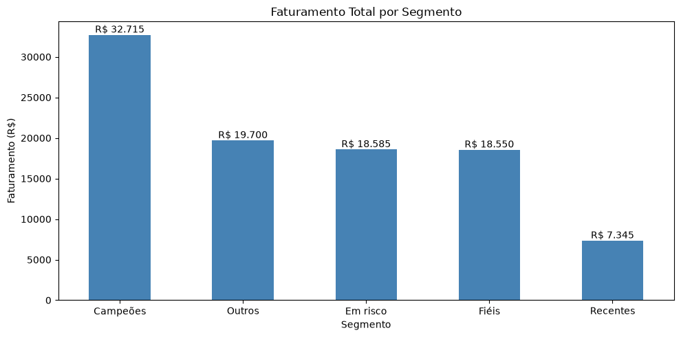
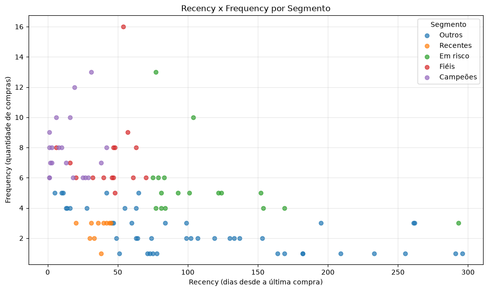
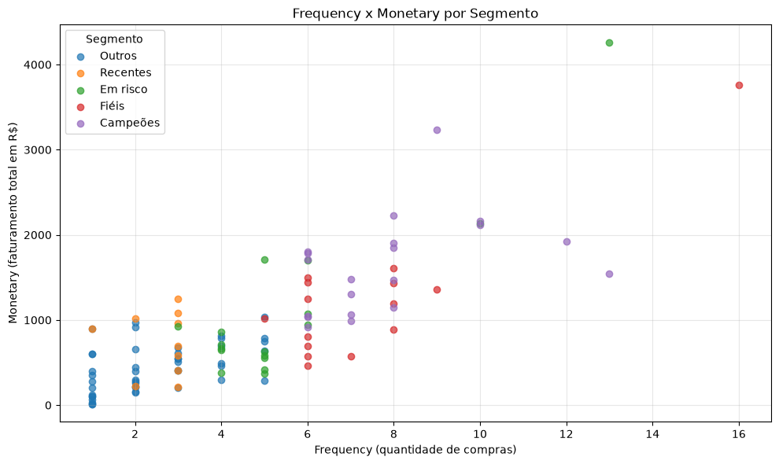

# 📊 Análise RFM e Segmentação de Clientes

Projeto de análise de dados desenvolvido em **Python e Jupyter Notebook**, com o objetivo de identificar padrões de comportamento de compra, segmentar clientes e gerar recomendações estratégicas para o negócio.

## 🎯 Objetivo

Aplicar a metodologia RFM (Recency, Frequency e Monetary) para identificar diferentes perfis de clientes e oportunidades de fidelização, retenção e crescimento.

## 🛠️ Tecnologias utilizadas

- Python
- Jupyter Notebook
- Pandas
- NumPy
- Matplotlib

## 📁 Estrutura do projeto

```text
analise-rfm/
│
├── imagens/
│   ├── clientes_por_segmento.png
│   ├── faturamento_por_segmento.png
│   ├── recency_frequency.png
│   └── frequency_monetary.png
│
├── analise_rfm.ipynb
├── README.md
└── vendas_ficticias.csv
```

## 📦 Base de dados

Foi criada uma base fictícia com 500 registros de vendas, contendo informações sobre clientes, compras, datas, quantidades e preços.

A variável `TotalPrice` foi criada para calcular o valor total de cada venda.

**Observação:** os dados são fictícios e foram desenvolvidos exclusivamente para fins educacionais.

## 🔎 Etapas do projeto

1. Geração e exploração da base de dados.
2. Verificação de valores ausentes e duplicados.
3. Tratamento e conversão dos dados.
4. Cálculo dos indicadores Recency, Frequency e Monetary.
5. Atribuição de pontuações RFM.
6. Segmentação dos clientes utilizando regras com NumPy.
7. Construção de visualizações e interpretação dos resultados.
8. Elaboração de recomendações de negócio.

## 📈 Resultados

| Indicador | Resultado |
|---|---:|
| Registros de vendas | 500 |
| Clientes compradores | 107 |
| Segmentos identificados | 5 |
| Faturamento total | R$ 96.895,00 |

### Distribuição de clientes

| Segmento | Clientes | Participação |
|---|---:|---:|
| Outros | 45 | 42,06% |
| Campeões | 20 | 18,69% |
| Em risco | 17 | 15,89% |
| Fiéis | 15 | 14,02% |
| Recentes | 10 | 9,35% |

### Faturamento por segmento

| Segmento | Faturamento | Participação |
|---|---:|---:|
| Campeões | R$ 32.715,00 | 33,76% |
| Outros | R$ 19.700,00 | 20,33% |
| Em risco | R$ 18.585,00 | 19,18% |
| Fiéis | R$ 18.550,00 | 19,15% |
| Recentes | R$ 7.345,00 | 7,58% |

## 📊 Visualizações

### 1. Quantidade de clientes por segmento



O segmento Outros concentra a maior quantidade de clientes, representando 42,06% da base.

### 2. Faturamento por segmento



O segmento Campeões apresenta o maior faturamento, representando 33,76% do total analisado.

### 3. Recency x Frequency



Permite observar a relação entre o tempo desde a última compra e a frequência de compras, destacando clientes que podem precisar de ações de reativação.

### 4. Frequency x Monetary



Permite analisar a relação entre frequência de compras e valor total gasto por cliente.

## 💡 Recomendações de negócio

- **Campeões:** priorizar fidelização e benefícios exclusivos.
- **Fiéis:** desenvolver programas de relacionamento e recompensas.
- **Recentes:** incentivar a segunda compra e aumentar a frequência.
- **Em risco:** desenvolver campanhas de reativação.
- **Outros:** investigar oportunidades de aumento do valor e da frequência de compra.

### Principal insight

O segmento Campeões representa apenas 18,69% dos clientes, mas concentra 33,76% do faturamento.

Isso demonstra que a maior quantidade de clientes não significa necessariamente a maior contribuição financeira para o negócio.

## 🧠 Aprendizados

Durante o desenvolvimento, foram praticados conceitos de:

- Análise exploratória de dados.
- Limpeza e transformação de dados.
- Agrupamento e agregação com Pandas.
- Engenharia de atributos.
- Segmentação RFM.
- Visualização de dados.
- Interpretação de indicadores e recomendações de negócio.

## ▶️ Como executar

Clone o repositório:

```bash
git clone https://github.com/carlosaugustosoares/analise-rfm-segmentacao-clientes
```

Instale as bibliotecas:

```bash
pip install pandas numpy matplotlib jupyter
```

Abra o Jupyter Notebook:

```bash
jupyter notebook
```

Execute as células do arquivo `analise_rfm.ipynb`.

---

**Projeto desenvolvido para fins educacionais.**
